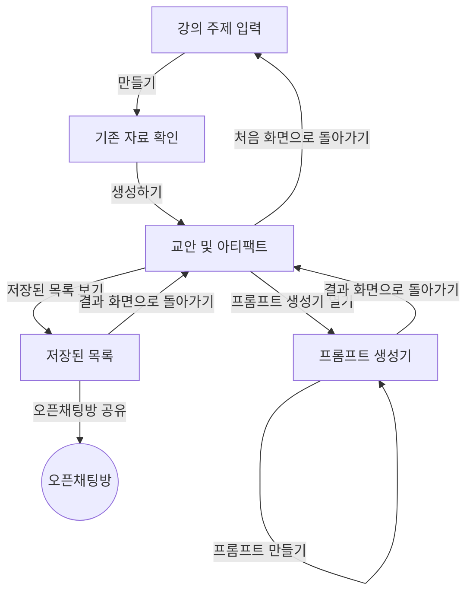

# PRD — 강의 주제 입력

- 상태 : 초안
- 한 줄 정의 : 시니어를 대상으로 강의를 하는 ai강사로 주5일 강의로 매번 주제가 바뀌어야하고 어느정도 ai에 익숙하다보니 초보대상이 아니다 보니 항상 강의 주제에 대해 고민이 많은 ai 강사가 쓰는 ai 강사가 사용하는 강의 교안 자동 생성기

## 1. 문제

### 배경
강사가 강의준비를 위한 교안과 실습제작 자료를 ai가 자동생성해주는 mvp다. 쓰는 사람은 설명과 실습을 적절히 섞은 ai수업을 혼자 진행하는 오프라인 ai 강사(나)이며, 시니어 대상으로 주 5일 강의를 진행해 매번 주제가 바뀌어야 하고, 수강생이 초보 대상이 아니라서 강의 주제에 대한 고민이 많다.

### 목표
강의가 매일 있다 보니, 강의 준비를 수월하게 하고 수강생들이 즐겁고 보람있는 강의를 듣게 하고 싶다.

"수월해졌다"를 아는 신호
- 주제 하나당 교안+실습자료 만드는 시간이 지금 약 ○시간인데, 30분 안에 끝난다
- 빈 화면 보며 "이 주제를 어떤 순서로 풀지" 고민하는 단계가 사라진다 — 초안이 나와 있고 고치기만 한다
- 전날 밤이나 당일 아침에 급하게 만드는 일이 없어진다
- 처음 다루는 주제가 배정돼도 부담이 없다 (지금은 낯선 주제일수록 준비 시간이 몇 배로 늘어남)
- 같은 주제를 다른 기관·다른 수준으로 바꿀 때 처음부터 다시 만들지 않는다

"즐겁고 보람있다"를 보는 신호
- 실습 시간에 손 놓고 계신 분이 거의 없다
- 수업 범위를 넘는 질문이 나온다 — "그럼 이건 어떻게 해요?"
- 끝나고 남아서 더 물어보거나, 다음 시간에 "집에서 해봤어요"라고 말씀하신다
- 각자 손에 결과물을 하나씩 들고 나간다 (만든 사진·영상·문서)

## 2. 사용자

### 페르소나
- 쓰는 사람 : 설명과 실습을 적절히 섞은 ai수업을 혼자 진행하는 오프라인 ai 강사 (나)
- 누구인가 : 나
- 언제 : 수업 난이도가 어렵다고 느껴질 때
- 왜 : 보조강사들은 난이도를 낮추자고 하지만, 어르신 수강생들은 재미있어 하셔서 의견이 갈림
- 지금은 어떻게 : 그냥 나는 진행해

### 사용자 스토리
1. AI 강사로서, 강의 주제를 넣으면 설명·실습 교안이 이미지와 함께 생기고 아티팩트도 같이 받고 싶다. (매번 강의 준비를 직접 짜지 않아도 되도록)
2. AI 강사로서, 프롬프트 생성기 같은 아티팩트도 만들고 싶다. (매번 같은 맥락을 다시 설명하지 않고, 내 수업 방식이 그대로 담긴 틀로 나오게 하려고 — 챗GPT에 매번 수강생 연령대·기기·시간 배분·수업 흐름을 다시 설명해야 하고 결과물 편차도 커서)
3. AI 강사로서, 교안과 아티팩트를 따로 분류해서 오픈채팅방에 링크로 공유하고 싶다. (그 링크로 수업을 진행하기 위해)
4. AI 강사로서, 만든 아티팩트를 잠그고 싶다. (수강생들이 미리 프롬프트를 만들어 크레딧을 소진하면 수업에 지장이 생기기 때문)
5. AI 강사로서, 강의 주제를 넣을 때 기존 교안·강의 내역과 겹치는지 스캔해서 보여주고, 필요하면 새로 만들고도 싶다. (겹치는 강의를 다시 만들지 않기 위해)
6. AI 강사로서, 여러 강사가 각자 로그인해서 계정을 따로 쓰고 싶다. (강사마다 자기 교안·아티팩트를 다른 강사와 섞이지 않게 따로 관리하고 싶어서)

## 3. 범위

### 넣을 기능
1. 주제를 넣으면 주제마다 설명과 실습에 대한 교안이 이미지와 함께 생긴다, 아티팩트도 함께 생성 (핵심)
2. 아티팩트도 생성되면 좋다. 프롬프트 생성기같은 것
3. 교안과 아티팩트는 따로 생성되서 분류해두면 강사가 따로 오픈채팅방에 링크를 공유해서 수업을 진행
4. 만든 아티팩트를 강사가 잠그는 기능
5. 강의 주제를 넣으면, 기존에 만든 교안·강의 내역을 전부 스캔해서 겹치는 강의가 있는지 확인하고, 있으면 기존 교안을 보여주고 새로 만들기도 할 수 있다
6. 여러 강사가 각자 로그인해서 계정을 따로 쓴다

### 기능 요구사항
1. 강의 주제를 넣으면, 설명·실습 교안이 이미지와 함께 생기고 아티팩트도 함께 생성된다.
2. 아티팩트 조건을 넣고 프롬프트 만들기를 누르면, 프롬프트가 생성되어 보인다.
3. 만들기를 누르면 교안과 아티팩트가 각각 분류되어 목록에 쌓이고, 오픈채팅방 공유를 누르면 그 목록의 링크가 공유된다.
4. 잠그기를 누르면, 수강생이 그 아티팩트로 프롬프트를 만들 수 없게 된다.
5. 강의 주제를 넣고 만들기를 누르면, 기존 교안·강의 내역을 스캔해 겹치는 자료가 있는지 확인해 비슷한 자료를 보여주고, "자료를 생성하시겠습니까"라고 물어본 뒤 생성하기를 누르면 교안이 만들어진다.
6. 로그인하면, 강사마다 자신의 교안·아티팩트를 따로 본다.

### 비목표
- 학생이 직접 접속해서 참여하거나 결제한다 — 강사 전용 도구이며, 학생은 만들어진 아티팩트만 쓸 수 있게 할 계획이라 뺌
- 만든 교안을 다른 강사와 실시간으로 같이 편집한다 — 강의는 혼자 하기 때문에 뺌
- 만든 교안과 아티팩트를 자동으로 이메일이나 문자로 발송한다 — 발송하는 기능은 두지 않음

### 예정 사항
지금 MVP 범위에는 넣지 않고 나중에 만들 기능이다. 어느 화면에 들어갈지와 수용 기준은 아직 정하지 않았다 (2026-11-03).
- 지난 초안을 글자로 찾는 칸
- AI를 최대한 활용한 멋있는 디자인으로 바꾸기 — 화면 배치·색·버튼은 클로드가 app.py 코드로, 배경·아이콘 같은 그림은 MCP로 연동된 마그네픽(Magnific)으로 만든다

## 4. 화면

### 사용자 흐름
- 강의 주제 입력 : 강의 주제를 넣고 만들기를 누른다.
- 기존 자료 확인 : 기존 교안·강의 내역과 겹치는 자료가 있는지 스캔해서 비슷한 자료를 보여주고, "자료를 생성하시겠습니까"라고 물어본다.
- 교안 및 아티팩트 : 만들어진 상세 교안과 아티팩트를 확인한다.
- 프롬프트 생성기 : 아티팩트 조건을 넣고 프롬프트 만들기를 눌러 프롬프트를 받는다.
- 저장된 목록 : 분류된 교안·아티팩트 목록을 보고 오픈채팅방에 링크를 공유한다.

## 5. 완성 기준

### 수용 기준
- pc에서도 열리고 모바일에서도 쉽게 열리는 구조로 만들어야한다.
- 강의 주제 입력 칸에 주제를 넣고 만들기를 누르면 → 기존 자료 확인 화면에 비슷한 자료와 "자료를 생성하시겠습니까" 문구가 보인다
- 기존 자료 확인 화면에서 생성하기를 누르면 → 교안 및 아티팩트 화면에 그것만 보고 수업을 진행할 수 있을 만큼 상세한 교안과 아티팩트가 보인다
- 프롬프트 생성기 화면에서 아티팩트 조건을 넣고 프롬프트 만들기를 누르면 → 프롬프트가 보인다
- 저장된 목록 화면에서 오픈채팅방 공유를 누르면 → 교안·아티팩트 목록의 링크가 공유된다
